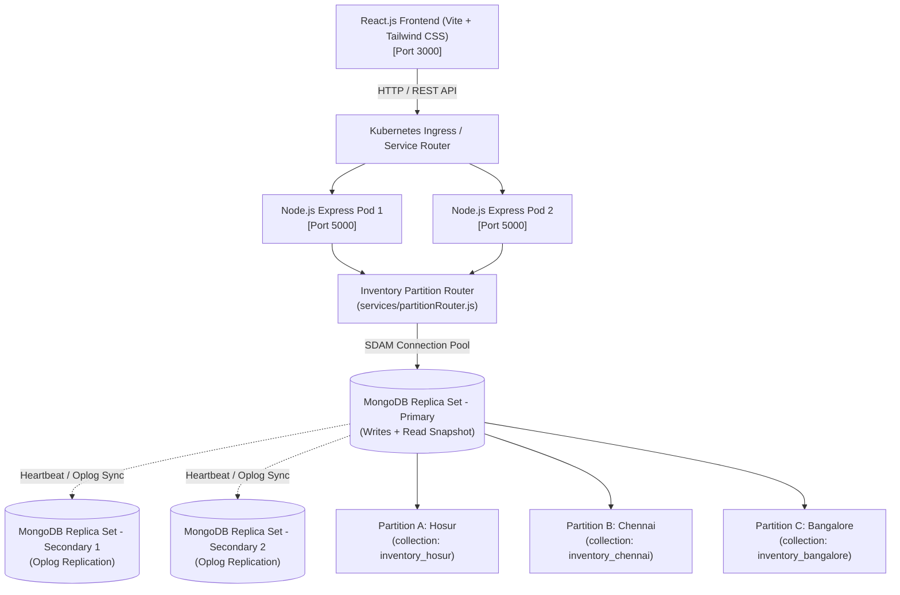
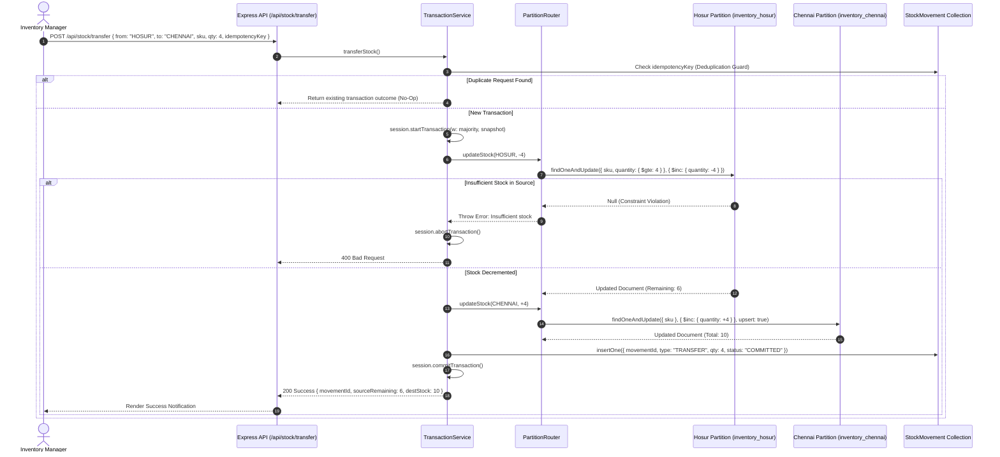

# System Architecture & Technical Specifications
## Cloud-Based Distributed Inventory Management System

### 1. High-Level System Architecture

---

### 2. Cross-Partition Atomic Stock Transfer Sequence (ACID)

---

### 3. Comparison: Replica Set vs Fragmentation vs Sharded Cluster

| Attribute | Replica Set (`rs0`) | Horizontal Fragmentation (This Project) | MongoDB Sharded Cluster |
| :--- | :--- | :--- | :--- |
| **Primary Purpose** | High Availability, Fault Tolerance, Redundancy | Regional Data Locality, Partition Isolation | Massive Horizontal Write/Storage Scale |
| **Data Distribution** | Every member holds a **complete clone** of the dataset | Distinct collections store **disjoint subsets** by warehouse | Chunks of collections distributed across independent shards |
| **Routing Mechanism** | Driver-level Server Discovery & Monitoring (SDAM) | Application-level `PartitionRouter` (`services/partitionRouter.js`) | Stateless `mongos` routing query server using config server metadata |
| **Transaction Boundary**| Native multi-document transactions supported | Managed atomically within same replica set or via 2PC | Distributed transactions managed across shard boundaries |
| **Hardware Overhead** | Moderate (3 nodes for quorum) | Low (Runs on single or multi-node instance) | High (At least 2 Shard replica sets + Config replica set + mongos) |
